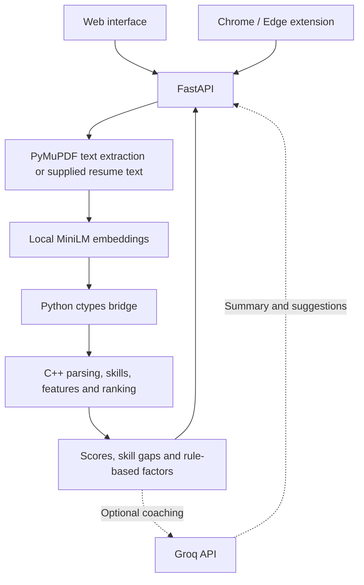

# TalentMatch AI

Resume-to-job matching with a native C++ scoring engine, a FastAPI web application, and a Chrome/Edge extension.

[Live demo](https://talentmatch-ai-jwqd.onrender.com/) · [Extension guide](docs/EXTENSION.md) · [API reference](docs/API.md) · [Development and validation](docs/DEVELOPMENT.md) · [Changelog](CHANGELOG.md)

The backend architecture is **v2**. The packaged browser extension is **1.2.1**. These versions describe separate components.

## Current features

- PDF resume uploads or plain-text resumes through the API.
- Overall match score and six category scores: skills, experience, education, projects, semantic alignment, and resume quality.
- Matched, missing, and partially matched skills, with rule-based strengths and areas for improvement.
- Native Aho-Corasick matching, BM25/TF-IDF retrieval features, and a deterministic weighted fallback scorer. XGBoost is optional and requires a compatible build and model.
- Optional Groq coaching: an AI summary and rewrite suggestions after scoring. A configured API key enables this external call; scoring itself does not need a key.
- Chrome/Edge popup with active-page job extraction, a locally saved resume text profile, and PDF text saving when “Remember this resume” is selected.
- Matching website and extension themes: cream/maroon in light mode and charcoal/terracotta in dark mode. Each interface remembers its own theme choice.
- Server-side file/text limits, generated temporary upload filenames, contained static file serving, escaped report text, and bounded client requests.

The web and extension results show overall and semantic scores. The API exposes all six category scores; the UI does not yet display each category separately.

## Architecture



The numerical scores and rule-based factors run in C++. Python handles validation, PDF extraction, embeddings, the native bridge, and optional coaching. The default Docker build disables XGBoost and uses the linear fallback. The first local embedding run may download the model; Docker downloads it during image building.

Matching and score reproducibility assume the same engine, model/configuration, and date-dependent inputs. Optional AI coaching is generated separately and can vary.

## Get started

Use Python 3.10 or newer, CMake 3.18+, a C++17 compiler, and Git. Install a Python version supported by the PyTorch and sentence-transformers wheels on your platform. UI tests require Node.js 22.13 or newer.

### Local API and website

From the repository root, build the engine:

```bash
# Linux / macOS
chmod +x scripts/build_engine.sh
./scripts/build_engine.sh
```

```powershell
# Windows: Visual Studio C++ workload or a configured MinGW toolchain
.\scripts\build_engine.ps1
```

Then create an environment and start FastAPI:

```bash
python -m venv .venv
# Linux / macOS:
source .venv/bin/activate
# Windows PowerShell instead: .\.venv\Scripts\Activate.ps1
pip install -r requirements.txt
uvicorn api:app --host 127.0.0.1 --port 8000
```

Open [the local website](http://127.0.0.1:8000/). FastAPI serves the frontend and `/api/score` from the same origin. Run from the repository root so model/configuration paths resolve correctly. Set `TALENTMATCH_LIB_PATH` if the compiled native library is outside the usual `cpp_core/build` locations.

The primary website uses `frontend/index.html`, `frontend/main.js`, and `frontend/style.css`. `frontend/src/` contains starter assets and is not the main interface. Docker copies the frontend source and serves the public files directly; it does not currently run a Vite build. A separately created `frontend/dist/` takes precedence when present.

`python app.py` starts the legacy Gradio development interface on port 7860; it is separate from the website.

### Docker

```bash
docker build -t talentmatch .
docker run --rm -p 8000:8000 talentmatch
```

Open [http://localhost:8000](http://localhost:8000). To enable coaching, pass `GROQ_API_KEY` through your runtime's environment management; never commit the key.

The existing `docker-compose.yml` still maps port 7860 and requires `.env`; it is a legacy configuration and does not match the default FastAPI container command. Use the commands above until that configuration is updated.

### Render

`render.yaml` defines the Docker web service and optional `GROQ_API_KEY` environment setting. Render supplies `PORT`. The free service may spin down when idle, so the first request can take longer. Clients stop waiting after 120 seconds and let the user retry.

Publishing source to GitHub does not establish that a Render deployment has completed. The extension store is a separate release channel. See the release checklist in [the development guide](docs/DEVELOPMENT.md).

## Inputs and API

| Input | Limit / behavior |
| --- | --- |
| Resume PDF | Up to 2 MiB; `.pdf` name and PDF header required; parsing must succeed |
| Resume text | Up to 100,000 characters; blank text rejected |
| Extracted PDF text | Up to 100,000 characters; textless PDFs rejected |
| Job description | Required, nonblank, up to 15,000 characters |
| Resume source | Supply a PDF or text, not both |

Text extraction uses PyMuPDF native text and text blocks. Scanned image-only resumes need OCR outside this application; there is no current OCR implementation.

`POST /api/score` accepts multipart form data. Its response includes scores, skill gaps, `feature_vector`, `match_summary`, and `suggestions`. `extracted_resume_text` is included only when `return_resume_text=true` is submitted. The API does not return a `parsed_resume` profile.

```bash
curl -X POST http://localhost:8000/api/score \
  -F 'pdf_file=@resume.pdf' \
  -F 'job_description=Backend engineer with Python and PostgreSQL experience'
```

`GET /api/health` returns 200 when the native engine is loadable and 503 when unavailable. It is not a complete embedding or coaching health check. See [the API reference](docs/API.md) for fields and errors.

## Extension 1.2.1

Download [talentmatch-extension.zip](talentmatch-extension.zip), extract it, and load the folder through your browser's developer extension page, or load the repository's `extension/` folder directly. The manifest must be at the selected folder's root.

The extension uses the hosted TalentMatch API by default. Its theme is saved locally and does not synchronize with the website. Resume profiles stay on the device until cleared or the extension is uninstalled; they are sent to the API when scoring is requested.

Rebuild the distributable after editing extension source:

```bash
python scripts/package_extension.py
```

The ZIP includes exactly `manifest.json`, `popup.html`, `popup.js`, `theme.js`, and `style.css`. For usage, permissions, and limitations, see [the extension guide](docs/EXTENSION.md).

## Privacy and security behavior

PDFs are saved under generated temporary server filenames and removed when request processing finishes. Scoring responses use `Cache-Control: no-store`. The application does not intentionally retain resume bodies or use them for training. This does not make guarantees about hosting-provider or external-service retention.

When the deployment has `GROQ_API_KEY`, coaching sends up to the first 2,500 resume characters, 1,500 job-description characters, and matched/missing skill names to Groq. There is no per-request coaching opt-out in the UI yet. Omit the key to run scoring without coaching. See [the privacy page](frontend/privacy.html).

The public API currently has no authentication, request throttling, or inference queue. Its synchronous inference runs inside the async request handler. The hardening changes do not constitute a comprehensive security audit or a production load guarantee.

## Tests and validation

```bash
pip install -r requirements-dev.txt
python -m pytest tests/test_api_security.py tests/test_coaching.py -q
npm install --prefix tests
npm test --prefix tests
```

Full pipeline checks also require the compiled engine and cached/downloadable embedding model:

```bash
# Bash: mock external coaching; use a previously cached embedding model.
MOCK_LLM=1 HF_HUB_OFFLINE=1 TRANSFORMERS_OFFLINE=1 python -m pytest tests/ -q
```

PowerShell equivalents and native regression commands are in [docs/DEVELOPMENT.md](docs/DEVELOPMENT.md). Only the bridge test class skips when the engine is missing; end-to-end pipeline tests still require it.

Validation recorded on November 25, 2026: **44 Python tests passed, five simulated UI/extension tests passed, and native matching/repetition regressions passed**. Both extension themes were rendered and visually inspected in headless Chrome. The Python run used mocked coaching and cached embeddings. Edge store installation, real job-board integration, live Groq calls, and a production deployment were not verified by those tests.

Historical throughput numbers in [BENCHMARK.md](BENCHMARK.md) predate these changes and do not establish thread safety or current production capacity.

## Optional XGBoost training

```bash
pip install xgboost scikit-learn
python scripts/train_model.py --samples 3000 --output models/xgboost_model.json
./scripts/build_engine.sh --xgboost
# Windows build option: .\scripts\build_engine.ps1 -EnableXGBoost
```

The bundled training script generates synthetic samples. It does not currently load real labeled datasets. XGBoost also needs discoverable native headers/libraries at build time. Keep model feature ordering aligned with `cpp_core/include/features.hpp`; validate and retrain after changing the training schema or feature definitions. An absent model or XGBoost dependency results in fallback scoring.

## Repository layout

| Path | Purpose |
| --- | --- |
| `api.py` | Input validation, temporary uploads, response contract, health and frontend serving |
| `src/pipeline.py` | PDF extraction, embeddings, native scoring and optional coaching orchestration |
| `src/bridge.py` | Native library discovery and ctypes memory handling |
| `cpp_core/` | Parser, skill matcher, feature extraction, retrieval, ranking and explanations |
| `frontend/` | Website, theme styles and privacy policy |
| `extension/` | Chrome/Edge popup, saved profiles and theme initialization |
| `models/` | Optional model and feature schema assets |
| `scripts/` | Native build, synthetic model training and extension packaging |
| `tests/` | API/coaching/pipeline tests, simulated UI tests and native regressions |
| `docs/` | API, extension and development/release guides |
| `CHANGELOG.md` | Current release changes |
| `BENCHMARK.md` | Historical performance results and validation limits |

## Contributors

| Contributor | Contributions |
| --- | --- |
| **Anshuman Pandey** | ML pipeline, native C++ engine architecture and v2 refactor |
| **Arnav Shukla** | Hosting and deployment, web interface and themes, Chrome/Edge extension, AI coaching integration, ATS warning additions, and benchmarking |

## License

[MIT](LICENSE).
